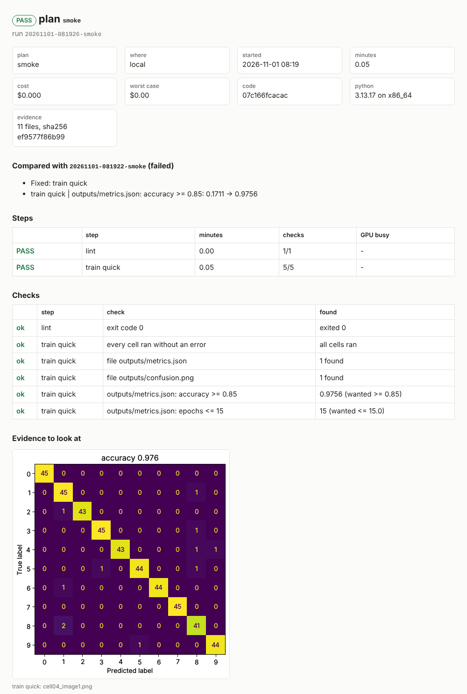

# agent-testbench

[](https://github.com/sarptandoven/agent-testbench/actions/workflows/ci.yml)
[](https://pypi.org/project/agent-testbench/)
[](https://github.com/sarptandoven/agent-testbench/blob/main/LICENSE)

**A test bench your coding agent operates.** testbench runs your code - tests, notebooks, training scripts, web
apps - on real machines: this one, a Docker sandbox, any box you reach with ssh, a Kubernetes cluster, a Modal GPU
or a Colab VM. It proves what the code did with **plans** (steps, checks and evidence), each priced before it
starts and stopped at its limit inside a budget the agent cannot raise, and every run leaves a **proof record**
anyone can check.

## Quick start

```bash
cd your-project && uvx agent-testbench check   # its tests, notebooks or app, run and proved here: no setup, free
```

With no testbench.yaml, `check` runs on this machine the plans `testbench init` would write for what it finds - a
pytest suite, `npm test`, `go test`, cargo tests, notebooks, a web app - and prints PASS or FAIL for each, the
report of each failure (the failing test, cell or line) and the one next step. It writes nothing but `.testbench/`.
Then:

```bash
pip install "agent-testbench[all]"   # or: uv tool install "agent-testbench[all]"
testbench demo                       # a small example project, run here for free (testbench demo --list)
testbench init                       # keep the plans in testbench.yaml, with a budget and AGENTS.md
testbench run <plan>                 # the report: what passed, what failed and why, what it cost
```

[Getting started](docs/getting-started.md) goes through a first project step by step, and
[the five-minute tour](docs/tour.md) shows it with screenshots.

## What you can do

### Prove a change

A plan says what "working" means, and `testbench run` checks it end to end in a fresh process:

```yaml
plans:
  smoke:                               # cheapest proof first: here, free
    backend: local
    steps:
      - name: tests
        run: python -m pytest -q --junitxml=junit.xml
        expect:
          junit: {path: junit.xml, failures: 0, tests: ">= 10"}       # names each failing test
      - name: train quick
        notebook: train.ipynb
        params: {EPOCHS: 1}                                           # Colab form fields
        expect:
          json: {outputs/metrics.json: {accuracy: "~= 0.93 +- 0.02"}}
          image: {outputs/confusion.png: {like: golden/confusion.png, max_diff: 0.05}}
```

```
$ testbench run smoke                  # after a bad edit to the data cell (abridged)
# FAIL - plan `smoke` on local
## FAIL: train quick
- **cell 2**: `AxisError`: axis 2 is out of bounds for array of dimension 2
- raised at cell line 10: X_train_mean = X.mean(axis=2) (raised in _methods.py:83, _count_reduce_items)
## Compared with the previous run `20261031-064113-smoke` (passed)
- Broke: train quick
```

Its report is a proof record: the commit it ran, where it ran, and the sha256 of every evidence file.
`testbench verify` checks the evidence later, `testbench diff` says what changed between two runs, and
`testbench share` publishes a run as a page anyone can check. Steps run notebooks, shell commands or web pages in
headless Chromium; `mocks: [openai, anthropic]` tests an LLM app against strict mock SDKs (no key, no network), and
`testbench rescue nb.ipynb` says why a notebook no longer runs. Read on: [expectations](docs/expectations.md),
[proof records](docs/proof-records.md), [notebooks](docs/notebooks.md), [mock clients](docs/mocks.md).



*`testbench report --format html` for the demo's fixed run - a real report, unedited ([the tour](docs/tour.md)).*

### Work live

```
$ testbench session start gpu --backend modal --gpu T4 --idle-minutes 3 --max-minutes 8
gpu  ready on modal T4  up 0.0 min, idle 0.0 min (stops after 3 idle / 8 total)  ~$0.000 so far
Within budget: up to $0.16 (today so far $0.01 of $2.00).

$ testbench exec "float(b.mean()), torch.cuda.max_memory_allocated() // 2**20"      # variables persist
[code | ok | 0.2 s]
=> (1023.1211547851562, 200)

$ testbench session stop
gpu stopped after 1.4 min, about $0.017
```

A kernel that stays up on any machine runs code, `.py` files or a notebook's cells (`exec --cells nb.ipynb:1-4`)
and gives back what they printed, the last value, plots as images and errors with their line. `files`,
`session install`, `shell` and `sync` move files, add packages and push your edits without losing variables. A
call past `--timeout` is interrupted and the kernel keeps its variables; a session stops itself when idle
([live sessions](docs/reference.md#live-sessions)).

### Improve it in a loop

```
$ testbench loop start smoke --metric outputs/metrics.json:accuracy --budget-usd 0
BASELINE: accuracy 0.86, run 20261031-054550-smoke passed.

$ testbench loop try "hidden units 8 -> 64"        # the agent edited the code; testbench commits, runs, judges
KEPT try 2: accuracy 0.9689 (best was 0.8689, +0.1). Run 20261031-054609-smoke passed. Best is now 509b79c25.

$ testbench loop try "learning rate 0.05 -> 0.1"
REVERTED try 3: accuracy 0.9689 is not better than the best 0.9689. The branch is back at 509b79c25.
```

Each idea is committed, proved by a run, and kept only if the number got better; one budget covers the whole loop,
and stopping rules (`--target`, `--patience`, `--max-tries`) end it. That is a real run: Claude Code, given only
the Claude Code plugin, took a model from 0.86 to 0.9756 accuracy in six tries, four kept and two reverted by
testbench, in 78 seconds ([the demo](docs/demo-loop.md), [loops](docs/loops.md)).

### Trade safely

A strategy never grades itself: the backtest writes its trades and equity, testbench computes the numbers, and the
strategy climbs a ladder - a backtest with costs, a look-ahead check, walk-forward windows, a sealed holdout opened
once, then paper trading on a mock broker and on Alpaca's paper API - with the deflated Sharpe ratio over every
try a loop made. `testbench demo trading` shows it in seconds: a backtest that looks superb, a planted look-ahead
caught, the one-line fix, every rung passed. testbench is not investment advice, and 0.3 does backtests and paper
trading only: [Trading with agents safely](docs/trading-safely.md).

### Add plug-ins

```toml
[project.entry-points."agent_testbench.backends"]     # in a package's pyproject.toml
rack = "testbench_rack:backend"                       # now `backend: rack` in testbench.yaml
```

A package can add a machine to run on, a check, a mock SDK, a place to export runs or send notifications, a
recipe or a metric reader. `testbench plugins` lists what is installed, and `testbench plugin test` checks that a
plug-in keeps its kind's contract - a backend, for one, must stop itself on the remote side
([plug-ins](docs/plugins.md)).

### From your editor, CI and code

```yaml
- uses: sarptandoven/agent-testbench@v1   # in a GitHub workflow: the report as the job summary, a pass or fail
  with:
    plan: smoke
    comment: true                         # the verdict and how the numbers moved, on the pull request
```

[The GitHub Action](docs/github-action.md) can also sign the report (`attest: true`); `testbench ci --for gitlab`
writes a job for GitLab, Azure Pipelines, CircleCI or any shell ([CI](docs/ci.md)).
[The VS Code extension](docs/vscode.md) shows plans, runs, the loop and today's spend, and runs a costly plan only
after you click Approve. From Python, `from agent_testbench import Testbench` runs plans and sessions, and
`agent_testbench.tools` gives the same tools to the Anthropic and OpenAI APIs, the OpenAI Agents SDK, LangChain and
the Claude Agent SDK ([Python API](docs/python-api.md)).

## Guardrails

- **Money**: a run's worst case - the hardware's price times its time limit - is checked before every run, session
  and loop. Above `max_run_usd` or a day's limit it is refused; above `ask_above_usd` a person approves.
  `~/.testbench/limits.yaml` caps every project on the machine, and a project can lower those limits, never raise
  them.
- **Hard stops** on the machine doing the work - Modal's timeouts, or a watchdog on Colab VMs, ssh machines,
  containers and pods - so the bound holds with your laptop asleep.
- **Secrets** go by name only, and a value the code prints is blanked out of everything a run keeps.
- **The guard hook** (Claude Code) asks you before every `--approve` and every edit that raises a budget. It is a
  safety net, not a sandbox: for code nobody reviewed, use `backend: docker` with `network: none`.

[The threat model](docs/threat-model.md) says who can do what, and names the test behind each guarantee.

## Install

```bash
pip install "agent-testbench[all]"           # or: uv tool install "agent-testbench[all]"
```

### Connect your agent

- **Claude Code**: the plugin adds the `iterate` and `setup` skills and the guard hook for spending and secrets
  (only the MCP server: `claude mcp add agent-testbench -- testbench mcp`). Then ask in plain words: *"get
  training working and prove it with the smoke plan"*, or *"use testbench loop to raise accuracy, budget $2"*.

  ```bash
  claude plugin marketplace add sarptandoven/agent-testbench
  claude plugin install agent-testbench@agent-testbench
  ```

- **Cursor, VS Code, Codex, Gemini CLI**: `testbench connect cursor` (or `vscode`, `codex`, `gemini`, `claude`;
  `--user` for every project, `--list` to see what is set up) registers the MCP server in the client's own config
  and writes the working rules into AGENTS.md.
- **Any other MCP client** (nothing to install with [uv](https://docs.astral.sh/uv/)):

  ```json
  { "mcpServers": { "agent-testbench": { "command": "uvx", "args": ["--from", "agent-testbench[all]", "testbench", "mcp"] } } }
  ```

- **Any other agent** reads the working rules `testbench init` writes into `AGENTS.md`.

The server's tools, resources and prompts, and which guardrails hold in which client:
[other coding agents](docs/clients.md).

### What each machine needs

- **Modal**: `modal setup` once (your account; [pricing](https://modal.com/pricing)).
- **Colab**: `uv tool install google-colab-cli`, then log in once (`colab new`). Uses your compute units.
- **ssh**: `ssh HOST true` must work with keys; `ssh: {host: HOST, usd_per_hour: 0}` in testbench.yaml.
- **Docker**: a running Docker (or podman); `docker: {network: none}` for no network.
- **Kubernetes**: kubectl with a context for your cluster; `kubernetes: {usd_per_hour: {cpu: 0, A100: 2.5}}`.
- **Trackers**: `pip install "agent-testbench[mlflow]"` or `[wandb]` for exports.
- **Web steps**: `playwright install chromium`.

`testbench doctor` shows what this machine can run. Each plan picks its machine (`backend:`), and so does each
session (`--backend`), so the same notebook can be proved for free here, then on the target GPU for a few cents
([backends](docs/backends.md)). Linux, macOS and Windows (Colab's CLI has no Windows build).

## Commands

`testbench --help` shows the core:

| | |
|---|---|
| **start** | |
| `testbench demo` | copy an example project, run its free plan, show what is next |
| `testbench check` | run every free plan here, even with no testbench.yaml |
| `testbench doctor` | check what this machine can run, and what to fix |
| **prove it with a plan** | |
| `testbench plans` | list the plans, their hardware and worst-case cost |
| `testbench estimate` | price a plan's worst case; say whether it may launch now |
| `testbench run` | run a plan and print its report |
| `testbench report` | print a run's report: markdown, json, html or junit |
| `testbench verify` | check a run's evidence against its recorded hashes |
| `testbench ui` | show every run as a page, or a live dashboard (--serve) |
| **work live, improve in a loop** | |
| `testbench session` | manage a live kernel: start, list, stop, sync, install, shell |
| `testbench exec` | run code or notebook cells in a session, see what came back |
| `testbench loop` | try changes one at a time; keep what a plan run shows is better |

`testbench help --all` adds the rest, in these groups:

| | |
|---|---|
| set up | `init`, `recipes`, `schema`, `connect`, `ci`, `selftest`, `mcp`, `plugins`, `plugin test` |
| runs | `wait`, `status`, `runs`, `cancel`, `watch` |
| proof | `diff`, `history`, `share`, `badge`, `export`, `numbers` |
| sessions and notifications | `files`, `notify test` |
| money | `spend`, `prices` |
| notebooks and the lab notebook | `lint`, `rescue`, `nb`, `note` |

`testbench help COMMAND` shows a command's options and examples, and [the reference](docs/reference.md#commands)
lists every command with its exit codes: 0 passed, 1 failed, 2 refused or bad input, 3 still running. A refusal
says what was refused, why, and the command or the testbench.yaml field that fixes it.

## Documentation

- **Start**: [getting started](docs/getting-started.md), [the tour](docs/tour.md), [why](docs/why.md),
  [use cases](docs/use-cases.md), [examples](docs/examples.md), [recipes](docs/recipes.md), real agent runs
  ([a loop improves a model](docs/demo-loop.md), [a suite fixed in a sandbox](docs/demo-sandbox.md),
  [a planted bug found](docs/demo.md))
- **Prove things**: [expectations](docs/expectations.md), [notebooks](docs/notebooks.md),
  [mock clients](docs/mocks.md), [rescue a notebook](docs/rescue.md), [proof records](docs/proof-records.md),
  [share a run](docs/share.md), [watch](docs/watch.md), [the dashboard](docs/dashboard.md),
  [exports](docs/export.md)
- **Work with agents**: [other coding agents](docs/clients.md), [VS Code](docs/vscode.md), [loops](docs/loops.md),
  [notifications](docs/notify.md), [the GitHub Action](docs/github-action.md), [other CIs](docs/ci.md),
  [Python API](docs/python-api.md)
- **Machines**: [backends](docs/backends.md), [Docker](docs/docker.md), [ssh](docs/ssh.md),
  [Kubernetes](docs/kubernetes.md)
- **Trading**: [trading with agents safely](docs/trading-safely.md), [files and metrics](docs/trading.md),
  [sealed data](docs/trading-data.md), [overfitting statistics](docs/trading-stats.md)
- **Plug-ins**: [plug-ins](docs/plugins.md), [how it fits together](docs/architecture.md)
- **Trust**: [threat model](docs/threat-model.md), [check it yourself](docs/verify.md), [FAQ](docs/faq.md)
- **Reference**: [testbench.yaml and every command](docs/reference.md), [troubleshooting](docs/troubleshooting.md)
- **Project**: [changelog](CHANGELOG.md), [contributing](CONTRIBUTING.md), [publishing](docs/publishing.md)

The same pages, with search: <https://sarptandoven.github.io/agent-testbench/>.

## How it is tested

`python -m pytest` runs everything that needs no account - notebooks in real kernels, expectations, budgets and
limits, the guard hook, the MCP server over stdio and HTTP, loops on real git repositories, the ssh backend through
a stand-in for ssh, Docker in real containers, web steps in Chromium - on Linux and macOS with Python 3.10 and
3.12, and on Windows. `tests/test_live.py` runs the same things on Modal, Colab or a real ssh host and is opt-in.
The demos in `docs/` are real agent runs.

## Limits

- Costs are estimates (time x price); `testbench spend --modal` reads Modal's actual bill; Colab unit rates vary by
  account (`colab usage`).
- It runs `.ipynb` files and live kernels; it does not drive the Colab or Modal Notebooks web pages.
- Colab VMs can be reclaimed after an hour or two even while busy; use Modal or ssh for long jobs.
- On Windows, interrupting a cell that is blocked inside a C call (`time.sleep`, a long native call) waits until
  that call returns; Python code is interrupted at once.

## License

MIT

<!-- mcp-name: io.github.sarptandoven/agent-testbench -->
